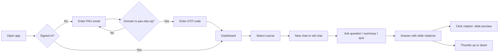
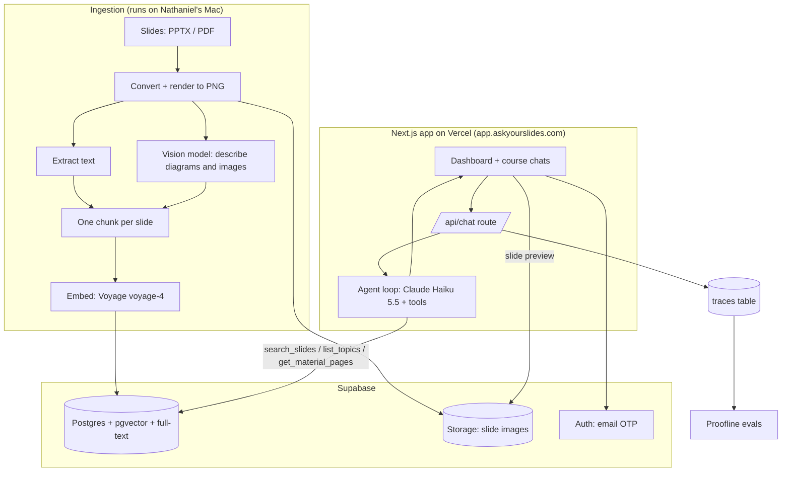
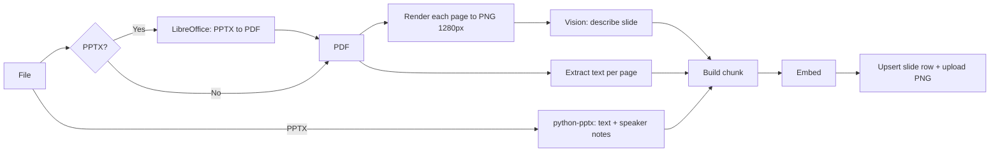
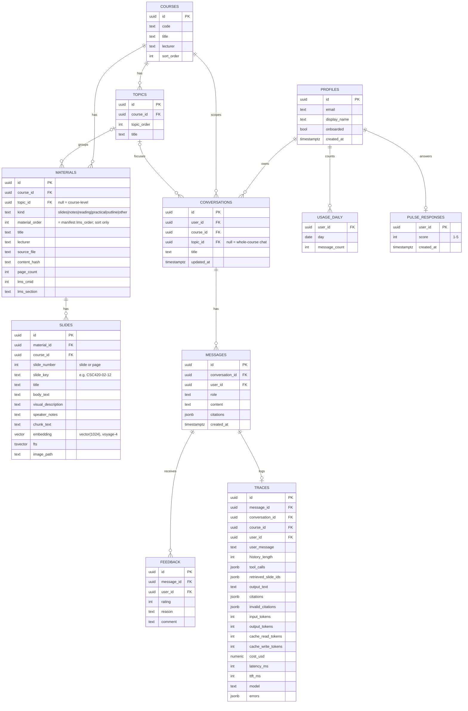
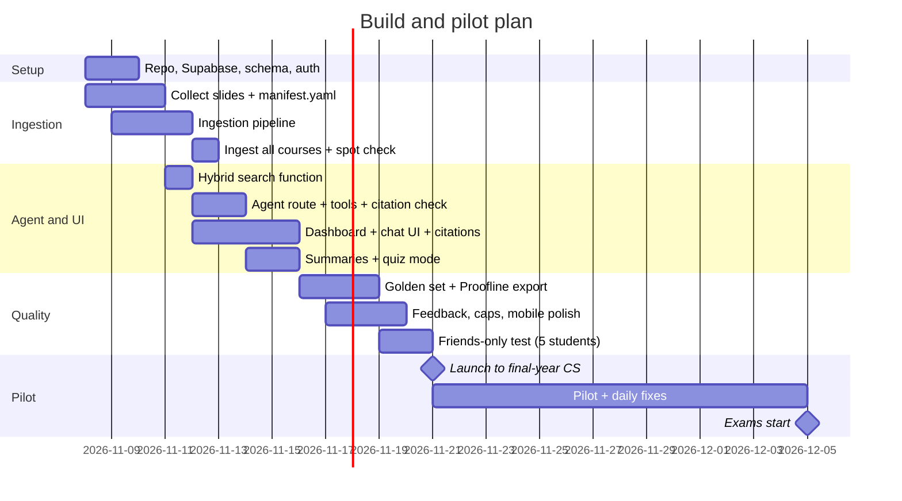

# PAU Study Assistant — Product Requirements Document

| Field | Value |
|---|---|
| Owner | Nathaniel Ilesanmi |
| Status | v1.2 — in build |
| Date | 7 November 2026 (v1.1: embeddings, auth email, domain, citation keys. v1.2: manifest-driven topics and materials, topic chats) |
| App URL | `app.askyourslides.com` (Vercel). Auth email from `noreply@mail.askyourslides.com`. |
| Pilot users | Final-year Computer Science students, Pan-Atlantic University (PAU) |
| Hard deadline | Exams start **5 December 2026**. Pilot must be live by **21 November 2026**. |

---

## 1. Summary

PAU Study Assistant is a web app. Final-year CS students sign in with their `@pau.edu.ng` email. They see one chat for each course. Each chat answers questions from that course's lecture slides, and it cites the slide it used.

The slides are already loaded. The student does not upload anything.

The app has a second purpose. It gives real users and real traces to **Proofline**, the agent evaluation harness. Each conversation becomes eval data.

---

## 2. Problem

Students already study with ChatGPT and Claude. But for each study session they must:

1. Find the correct slide decks on the school portal.
2. Download them.
3. Upload them into a chat again and again (file limits, new chats, lost context).
4. Trust answers that do not show which slide they came from.

Near exams, this friction costs time. Answers that mix slide content with general knowledge also confuse students. They do not know what the lecturer actually taught.

---

## 3. Goals and non-goals

### 3.1 Goals (MVP)

| ID | Goal |
|---|---|
| G1 | A student can ask a question about any final-year CS course and get an answer grounded in that course's slides, with slide citations. |
| G2 | The answer shows clearly which parts come from the slides and which parts are general knowledge. |
| G3 | A student can ask for a summary of a topic, a material, or the whole course. |
| G4 | A student can ask the assistant to quiz them on a topic. |
| G5 | Pilot is live for students by 21 November 2026, two weeks before exams. |
| G6 | Every request writes a trace that Proofline can use. |
| G7 | Cost stays predictable, with a hard daily cap per student. |

### 3.2 Non-goals (MVP)

- Other departments or levels.
- Per-student course enrollment. All CS final-year courses show for all students.
- Live web search. General knowledge comes from the model only.
- Past questions (v2).
- Voice (v2).
- Mobile app (v2).
- MCP server / integration with NotebookLM and other tools (v2).
- Student file upload.
- Payments.

---

## 4. Users

| Persona | Description | Main need |
|---|---|---|
| Exam crammer | Final-year CS student, 1–3 weeks before exams. Studies late at night, mostly on a laptop, sometimes on a phone. | Fast, correct answers tied to what the lecturer taught. |
| Catch-up student | Missed lectures. Has never opened some materials. | Summaries of topics, in order. |
| Self-tester | Knows the material, wants to check it. | Quiz questions with answers and slide references. |
| Builder (Nathaniel) | Owner and operator. | Traces, feedback, cost visibility, easy re-ingestion of slides. |

---

## 5. Success metrics

The primary signal is **direct student feedback**: students say it helped, and they can say how.

| Metric | Target for pilot (21 Nov – 5 Dec) | Source |
|---|---|---|
| Students who sign in | ≥ 30 | `profiles` table |
| Weekly active students | ≥ 50% of signed-in students | `messages` table |
| Thumbs-up rate | ≥ 75% of rated answers | `feedback` table |
| Survey: "It helped me study" (agree / strongly agree) | ≥ 70% | End-of-pilot survey |
| Citation precision (cited slide supports the claim) | ≥ 90% on the golden set | Proofline |
| p95 time to first token | ≤ 3 s | Traces |
| LLM cost | ≤ $100 for the full pilot | `usage` table + provider dashboard |

---

## 6. Scope — features and acceptance criteria

### F1. Sign in with school email

- The student enters an email. The app sends a 6-digit one-time code (OTP). The email template shows the code (`{{ .Token }}`), not a magic link.
- Emails go through Resend (custom SMTP in Supabase) from `noreply@mail.askyourslides.com` on a verified domain.
- Only `@pau.edu.ng` addresses are accepted. The server rejects all other domains before it sends a code. A Supabase auth hook enforces the same rule, so calling Supabase directly with the public key cannot bypass it.
- First sign-in asks for a display name (optional).

**Acceptance**
- `someone@gmail.com` → error "Use your PAU email." No email is sent.
- `student@pau.edu.ng` → code arrives, sign-in works, session lasts 30 days.

### F2. Dashboard with course and topic chats

- After sign-in, the student sees a sidebar with one item per course (code + title, e.g. "CSC 420 — Data Management II").
- Under the selected course: **Whole course**, then the course's **topics** in order (from `data/manifest.yaml`). Each has its own conversations and a "New chat" button.
- A chat is either a **whole-course chat** (`topic_id` null) or a **topic chat**.
- The main area shows the selected conversation.
- **Laptop first** (most students study on a laptop): sidebar, chat and slide preview side by side. Still works on a phone: the sidebar becomes a drawer and the preview a bottom sheet.
- Topics with no material yet are hidden from the sidebar (they stay in the manifest and appear once a file is ingested).

**Acceptance**
- All configured courses and their topics show for every student.
- A chat in CSC 420 only ever retrieves CSC 420 material.
- A topic chat retrieves from its topic first. When the topic does not cover the question, it falls back to the whole course and the answer carries a clear label (F3).

### F3. Grounded Q&A with slide citations

- The agent searches the course materials before it answers.
- **Sources by kind** (set per file in the manifest):
  - `slides`, `notes`: main source for answers.
  - `reading`: supporting source, used for depth. Ranked below slides and notes on equal evidence, and labelled as a reading when cited.
  - `practical`: hands-on tasks; used for practical questions and quizzes.
  - `outline`: course-level overview; feeds whole-course overviews, not normal search.
  - `other`: used only when the student asks for it directly (e.g. "the project brief").
- Each claim from the materials has a citation chip, e.g. `Parsing · Slide 12`, `Reading: Contextual integrity · p. 4`.
- Clicking a chip opens a preview of the slide/page image and its text.
- **Topic chats**: search the topic first. If the topic has no good match, search the whole course and show a label above the answer: "Not in *{topic}* — from elsewhere in {course}". Chips from other topics show their topic name.
- If no course material covers the question, the agent says so first.

**Acceptance**
- 100% of citations point to slides that the agent actually retrieved in that turn (validated on the server).
- In a topic chat, an answer that uses material from outside the topic always carries the fallback label.
- On the golden set, ≥ 90% of cited slides support the claim.

### F4. General knowledge marking

- Content that does not come from the slides is shown in a highlighted box labelled **"Not from your slides — general knowledge"**.
- The agent uses general knowledge only to explain or extend. It never contradicts the slides without saying so.

**Acceptance**
- In the golden set, every answer segment without a citation is inside a general-knowledge box.
- Visual: the box uses a different background color and an icon. It is easy to see on a phone.

### F5. Summaries

- The student can ask: "Summarize this topic", "Summarize the privacy slides", "Give me an overview of the whole course".
- **Topic summary**: the agent reads the topic's `slides` and `notes` materials in order (readings only if asked, or as a short "go deeper" pointer) and writes a structured summary with citations.
- **Course overview**: built from the course's `outline` materials, then one section per topic in topic order.
- There is no "week" concept: lecturers number and name files inconsistently. The unit is the **topic**, defined in the manifest. A request like "summarize week 3" is matched against `list_topics` (which includes each material's LMS section, often a date range); if more than one topic could fit, the agent asks which one.

**Acceptance**
- A topic summary cites slides from across all of the topic's materials, not only the first few slides.
- A whole-course overview has one section per topic and uses the outline when one exists.

### F6. Quiz me

- The student asks: "Quiz me on regular expressions" (optional: number of questions, difficulty).
- The agent generates questions from retrieved slides. MVP format: one question at a time in chat; the student answers; the agent marks it and cites the slide with the correct answer.

**Acceptance**
- Each question is answerable from the cited slides.
- The agent does not show the answer before the student replies (unless asked).

### F7. Feedback

- Thumbs up / thumbs down on every assistant message. Thumbs down opens an optional short reason ("wrong", "not in slides", "too long", "other" + text).
- A one-question in-app prompt after the 10th message: "Is this helping you study? (1–5)".
- End-of-pilot survey link (external form) shown as a banner from 3 December.

### F8. Usage cap

- Each student has a daily cap of **50 messages** (configurable).
- When a student reaches the cap, the input is disabled with the message "Daily limit reached. Resets at midnight (WAT)."

### F9. Admin and operations (no UI in MVP)

- An ingestion CLI loads and re-loads course slides.
- SQL views show daily active users, messages, cost, and thumbs-up rate.
- All traces export to Proofline format (JSONL).

---

## 7. User flow



---

## 8. System architecture



### 8.1 Technology choices

| Layer | Choice | Reason |
|---|---|---|
| Web app | Next.js (App Router) + TypeScript + Tailwind + shadcn/ui | Fast to build, good streaming support. |
| Hosting | Vercel (free tier for pilot), `app.askyourslides.com` (domain on Namecheap) | Zero-ops deploys. |
| Auth | Supabase Auth, 6-digit email OTP | Built-in, domain check in the API route **and** a "before user created" auth hook. |
| Auth email | Resend as Supabase custom SMTP, sender `noreply@mail.askyourslides.com` (verified domain) | Supabase's built-in email only reaches project team members; a verified domain also reduces spam-folder risk. |
| Database | Supabase Postgres + `pgvector` + Postgres full-text search | One store for app data, vectors, and keyword search. |
| File storage | Supabase Storage | Slide PNGs for citation previews. |
| Chat model | Claude Haiku 5.5 (`claude-haiku-5-5`) | Low cost, fast, good tool use. Swap is one config value. |
| Vision (ingestion) | Claude Haiku 5.5 with image input | Describes diagrams, tables, equations, scanned slides. |
| Embeddings | Voyage AI `voyage-4` (1024 dims). `input_type: "document"` for slides, `"query"` for searches. | Strong retrieval quality, very low cost. The vector column is `vector(1024)`; changing the model or dimension means a migration and a full re-embed. |
| Agent framework | Vercel AI SDK (`ai` + `@ai-sdk/anthropic`) | Streaming, tool calls, React hooks. |
| Ingestion | Python 3.12 script (`python-pptx`, `PyMuPDF`, LibreOffice headless) | Best libraries for PPTX/PDF. |
| Evals | Proofline (own harness) | Real traces from real users. |

---

## 9. Ingestion pipeline

### 9.1 Input layout

Course files are never committed to git. They live in `data/` (git-ignored).

```
data/
  courses.yaml        # course code, title, lecturer, LMS id; order = sidebar order
  manifest.yaml       # SOURCE OF TRUTH for structure: course → topics → materials
  slides/
    CSC420/
      01-PAU-CSC420-Outline.pdf
      02-PAU-CSC420-Lecture1-Transactions-Indexing.pdf
      ...
```

`manifest.yaml` (abridged):

```yaml
courses:
  CSC420:
    topics:
    - order: 1
      title: Transactions and indexing
    materials:
    - lms_order: 1                 # = material order; unique per course
      lms_cmid: 82084              # LMS id; used to detect new files on re-sync
      lms_section: General
      file: slides/CSC420/01-PAU-CSC420-Outline.pdf
      topic: null                  # null = course-level (whole-course chat only)
      kind: outline                # slides | notes | reading | practical | outline | other | skipped
    - lms_order: 4
      file: null
      kind: skipped                # never ingested
```

Rules:

- **Topics** come only from the manifest, in its `order`. A material's `topic` must name one of its course's topics, or be `null`.
- **Kind** decides how a material is used (F3). `skipped` rows are not ingested and not stored.
- Rows with a `review:` note are judgment calls; ingestion prints them so they get checked, but does not block on them.
- **Material order** = `lms_order`, used for sorting only. The material title comes from the filename (minus the order prefix and course code) or the first slide's title.
- Each slide/page gets a short, stable `slide_key`: `{course}-{material order}-{page}`, e.g. `CSC420-02-12`. Citation markers use it (§10.4).
- Ingestion fails fast, before any upload, if the manifest names a missing file, an unknown topic, an unknown kind, or a course not in `courses.yaml`.

### 9.2 Steps



0. **Read the manifest**, validate it (§9.1), drop `kind: skipped`, and upsert courses and topics.
1. **Normalize**: convert PPTX/PPT to PDF with LibreOffice headless. This gives one page per slide and a consistent renderer.
2. **Render**: each page → PNG (1280 px wide). Upload to Supabase Storage at `slides/{course}/{material order}/{n}.png`.
3. **Extract text**: from PPTX use `python-pptx` (titles, body, tables, speaker notes). From PDF use PyMuPDF.
4. **Describe visually**: send the PNG to the vision model **only if** the slide has an image, chart, table, or equation, or if extracted text is shorter than 40 characters (scanned slide). Prompt: describe the diagram, transcribe any equations and tables, keep it under 150 words.
5. **Build chunk**: one chunk = one slide or page. Content:
   ```
   Course: CSC420 Data Management II
   Topic: Transactions and indexing
   Material (slides): Transactions and Indexing (slide 12 of 31)
   Title: B+-tree index
   Text: ...
   Visual description: ...
   Speaker notes: ...
   ```
   The header gives context to the embedding and to the model.
6. **Embed** the chunk text with Voyage `voyage-4` (`input_type: "document"`, 1024 dims). Store the vector; Postgres generates the `tsvector` for full-text search from the chunk text.
7. **Idempotency**: each material has a content hash (file bytes + its manifest row). Re-running ingestion skips unchanged materials and replaces changed ones. Moving a file to another topic or kind in the manifest updates it without re-running vision. Materials removed from the manifest (or switched to `skipped`) are deleted.

### 9.3 Size and cost estimate

- Pilot data (manifest of 7 Nov 2026): **7 courses, 41 topics, 62 materials** (38 PDF, 24 PPTX; 6 more listed as skipped). Page count to be measured on first ingest; readings can be long, so expect ~2,000–4,000 pages.
- Vision calls on ~50% of slides. Total ingestion cost: about **$1–3**. Embeddings: ~1–2M tokens with Voyage, well under $1 (check current Voyage pricing and free allowance).
- Run time: about 20–40 minutes, with parallel vision calls.

---

## 10. Retrieval and agent design

### 10.1 Agent loop

```mermaid
sequenceDiagram
    participant S as Student
    participant A as /api/chat
    participant M as Claude Haiku 5.5
    participant D as Postgres

    S->>A: message + conversation_id (course and topic come from the conversation)
    A->>A: auth check, daily cap (atomic), save user message
    A->>A: embed query (Voyage voyage-4, input_type query)
    A->>D: first search_slides, run by the server (topic first; widen if another topic is clearly better)
    D-->>A: top slides
    A->>M: system prompt + history + question + that search as the model's own tool call
    M-->>A: optional further tool calls (search again, list_topics, get_material_pages)
    M-->>A: streamed answer with [[s:slide_key]] markers and <general> blocks
    A->>A: validate citations and drop narration on the stream, save message + trace
    A-->>S: streamed answer, rendered with chips and boxes
```

**Why the server runs the first search.** Measured on the real courses (`npm run check:agent`):
prompting alone did not guarantee retrieval (the model sometimes answered from memory), and forcing
the model to call a tool cost a whole extra model round trip before the first word. Running the
first search on the server guarantees retrieval before every answer and saves that round trip. The
query is the student's message, plus the previous question for short follow-ups ("how is that
different?", a quiz answer like "c").

### 10.2 Tools

| Tool | Input | Output | Used for |
|---|---|---|---|
| `search_slides` | `query: string`, `k?: number (default 8)`, `scope?: "topic" \| "course"`, `include?: ("outline" \| "other")[]` | `{scope_used, fell_back, results: [{slide_key, material_title, material_kind, topic_title, outside_topic, slide_number, title, content, prev_title, next_title}]}` | Q&A, quizzes |
| `list_topics` | — | Topics in order, each with its materials `{material, title, kind, pages, lms_section}`, plus course-level materials (outlines, other). `material` is a short key, e.g. `CSC420-02` | Summaries, overviews, "what's in this course?", "week 3" |
| `get_material_pages` | `material` (key from `list_topics`), `from?`, `to?` | Pages in order (max 40 per call, content capped at 1,500 characters per page) | Topic summaries, course overview from the outline |

`course_id` and `topic_id` are **not** tool parameters. The server injects them from the conversation. The model cannot search other courses.

**Topic-first search with fallback** (`search_slides` in a topic chat):

1. Search the topic (`match_slides(..., p_topic_id)`).
2. Search the whole course at the same time. **Widen** (use the whole-course results) if the topic has no results, or if the best similarity outside the topic beats the best inside it by more than a margin (0.05, to be calibrated on the golden set). A fixed similarity cutoff does not work: across the 7 courses, right-topic scores ranged 0.39–0.75 and wrong-topic scores 0.33–0.71. Results from other topics carry `outside_topic: true`; the response carries `fell_back: true`.
3. The model may also ask for `scope: "course"`, but only when the student asks to connect topics. It is told not to widen on its own; the server decides.
4. When any cited slide is outside the topic, the server sends a `fallback` flag with the answer and the UI shows the label (F3). The label comes from the server, not from the model's wording.

In a whole-course chat, `search_slides` searches all topics; `scope` is ignored.

### 10.3 Hybrid search

0. Candidates: slides of the course, optionally of one topic, whose material kind is in the requested set (default `slides`, `notes`, `practical`, `reading`).
1. Vector search: top 20 by cosine similarity, filtered by `course_id`. The query is embedded with `voyage-4`, `input_type: "query"`. No vector index: one course is ~300 slides, so an exact scan is fast and never drops results the way a filtered approximate index can.
2. Full-text search: top 20 by `ts_rank_cd` on the same course, with query terms OR-ed (AND would match almost nothing for natural questions). This catches exact terms ("LL(1)", "Dijkstra", "CSC 401").
3. Merge with Reciprocal Rank Fusion (k = 60). Multiply a `reading`'s fused score by 0.85 so slides and notes win on equal evidence. Return top `k`, each with its cosine similarity (the fallback signal).
4. Add neighbor context: for each result, include the title of the slide before and after (helps with slides that continue a topic).

Implemented as one Postgres function `match_slides(course_id, query_embedding, query_text, k, topic_id?, kinds?)`.

### 10.4 Answer format contract

The model writes Markdown with two extra conventions:

- **Citation marker**: `[[s:<slide_key>]]` placed after the sentence it supports, e.g. `[[s:CSC401-04-12]]`. Short keys instead of UUIDs, because a small model mis-copies 36-character IDs.
- **General knowledge block**:
  ```
  <general>
  ...text that does not come from the slides...
  </general>
  ```

The server and the UI enforce the contract:

- The UI renders `[[s:...]]` as a citation chip and `<general>` as a highlighted box.
- The server checks that every cited `slide_key` was returned by a tool in this turn. The check runs on the stream: a marker is held back until it is complete, then forwarded or dropped, so the student never sees an invalid chip. Invalid citations are logged as a trace error (`citation_invalid`). This is a Proofline metric.
- Because only this turn's slides count, the agent searches again when it needs a slide from an earlier turn (e.g. marking a quiz answer). Earlier answers go back to the model as history with their markers intact; stripping them made the model believe it had answered without searching.
- **Narration guard**: text the model writes just before a tool call ("I'll pull all its pages…") is held back and dropped (`narration_dropped` in the trace). A text block streams as soon as it is longer than 120 characters or its step ends without a tool call.

### 10.5 System prompt (outline)

1. Role: study assistant for `{course_code} {course_title}` at Pan-Atlantic University; in a topic chat, focused on `{topic_title}`.
2. Always call `search_slides` (or `list_topics` + `get_material_pages` for summaries) before answering a course question.
   - Slides and notes are the main source. Use readings for depth, and say when a point comes from a reading. Use practicals for hands-on questions. Use `other` material only when the student asks for it.
   - In a topic chat, stay on the topic. If results are marked `outside_topic`, say plainly that this part comes from elsewhere in the course.
3. Cite every claim that comes from the slides with `[[s:slide_key]]`.
4. Put all content that is not from the slides inside `<general>` blocks. Keep general knowledge short and useful.
5. If the slides do not cover a question, say "Your slides don't cover this." first, then give general knowledge inside `<general>`. Only for questions: never for summaries or quizzes, and not when the slides answer part of the question (asking for the exact words without these limits made the model open summaries and quizzes with that sentence).
6. If the slides and general knowledge disagree, follow the slides and point out the difference.
7. Quiz mode: one question at a time; wait for the answer; mark it; cite the slide.
8. Style: clear, short paragraphs, examples where they help, exam-focused.
9. Do not help with active exam cheating (e.g. "answer this question during my exam now"). Normal revision is always fine.

### 10.6 Context and cost controls

- Send at most the last 12 messages of history.
- Tool results: max 8 slides for search, 40 pages per material read.
- Max output: 1,200 tokens (2,000 for summaries: when the message asks for a summary/overview or the agent reads whole materials).
- Prompt caching: tools + core instructions are one shared cached prefix for every chat (Haiku 5.5 caches from 512 tokens); a second breakpoint on the new question serves the later steps of the same turn.
- Thinking off for chat (`thinking: disabled`, allowed on Haiku 5.5 at default effort): answers are grounded in retrieved slides, and thinking delays the first word.

**Measured** (agent check, 8 real questions, server on a Mac in Lagos): about $0.001 per answer ($0.0005–0.0026), so 15,000 messages ≈ $15. Time to first word: 2.5–3.7 s for questions, about 5.5 s for a whole-lecture summary. The PRD target (p95 ≤ 3 s) is not met yet; re-measure on Vercel before tuning further (the search step alone is 0.75–1.2 s from here).

---

## 11. Data model



### 11.1 Row-level security

- `courses`, `topics`, `materials`, `slides`: readable by any authenticated user. Writable only by the service role (ingestion).
- Integrity: a material's topic and a conversation's topic must belong to the same course (composite foreign keys). `skipped` is not a valid stored kind.
- The `slides` table keeps its name; a row is one slide or one page of any material.
- `conversations`, `feedback`, `pulse_responses`: a user can read and write only their own rows.
- `messages`: a user can read only their own rows. Only the server writes messages, so a student cannot plant a fake assistant message into the history the model sees.
- `profiles`: a user can read their own row and change only `display_name` / `onboarded`.
- `traces`, `usage_daily`: service role only. The UI gets today's count from `my_usage_today()`.
- Slide images: private Storage bucket, served only as expiring signed URLs.

---

## 12. API

| Method | Route | Purpose |
|---|---|---|
| POST | `/api/auth/otp` | Validate domain, request OTP from Supabase. |
| POST | `/api/chat` | Stream an agent answer. Body: `{conversation_id, message}`. Course and topic come from the conversation row. |
| GET | `/api/courses` | List courses with their topics. |
| GET/POST | `/api/conversations` | List / create conversations for a course, optionally a topic (`topic_id` null = whole course). |
| GET | `/api/conversations/:id/messages` | Load history. |
| POST | `/api/feedback` | Save thumbs up/down + reason. |
| GET | `/api/slides/:id` | Slide preview: signed image URL + text. |

---

## 13. UI

### 13.1 Screens

1. **Sign in** — email field → OTP field. PAU branding kept neutral (no official logo unless the school approves).
2. **Dashboard** — left sidebar: course list (code + short title). Under the selected course: **Whole course**, then its topics in order; under the selected one, its conversations + "New chat". Main area: empty state with three starter buttons. Topic chat: "Ask about {topic}", "Summarize this topic", "Quiz me on this topic". Whole-course chat: "Ask a question", "Course overview", "Quiz me".
3. **Chat** — messages with streaming; citation chips; general-knowledge boxes; thumbs on each answer; input box with remaining daily messages shown when < 10.
4. **Slide preview** — side panel next to the chat (laptop) or bottom sheet at 75% height (phone) with the slide/page image, material title and kind, topic, slide/page number, and a link "Ask about this slide".

### 13.2 Rendering rules

- Citation chip: small rounded label, course color. The slide/page number is never truncated; only the title part is shortened. Text by kind: `slides` → `{material} · Slide 12`; `notes` / `practical` → `{material} · p. 12`; `reading` → `Reading: {material} · p. 4`. Truncated on phones. Never "Week n". Multiple chips can follow one sentence.
- In a topic chat, a chip from another topic adds the topic name (`Privacy › Slides-Privacy · Slide 3`) unless the material title already says it, and the answer has a label above it: "Not in *{topic}*: from elsewhere in {course}".
- General-knowledge box: amber/neutral background, left icon, label "Not from your slides".
- Laptop first: designed and tested at 1440×900; also tested at 375 px (no sideways scrolling, drawer, bottom sheet).

---

## 14. Cost model

Assumptions per message: ~6,000 input tokens (system prompt + history + 8 slides), ~500 output tokens. Prices: Claude Haiku 5.5 at $0.10 per million input tokens and $0.50 per million output tokens (prompts under 100K tokens). Check prices on the provider page before launch.

| Scenario | Messages / month | Estimated LLM cost / month |
|---|---|---|
| 50 students × 10 msgs/day × 30 days | 15,000 | ≈ $13–25 |
| 100 students × 15 msgs/day × 30 days | 45,000 | ≈ $40–70 |
| Worst case: 100 students × 50 msgs/day (cap) | 150,000 | ≈ $130–230 |

Hosting: Vercel free tier and Supabase free tier are enough for the pilot (check the Supabase 500 MB database limit: 3,000 slides × ~8 KB ≈ 25 MB, fine).

**Controls**: daily cap per student (F8), history limit, output limit, prompt caching, and a provider-side monthly spend limit.

**After the pilot** (not MVP): options are a free tier + paid tier, a department or sponsor paying, or a cheaper model for simple turns.

---

## 15. Observability and Proofline integration

Each assistant turn writes one `traces` row:

- Input: user message, course, conversation history length.
- Tool calls: name, arguments, returned `slide_key`s, latency.
- Output: final text, citations, invalid citations removed.
- Tokens, cost, model, total latency, time to first token.
- Feedback (joined later).

**Export**: `npm run export:traces -- --since 2026-11-21` writes JSONL (`evals/README.md` has the format, drafted from this section; student ids are pseudonymised). Each line also carries the deterministic checks below.

**Proofline checks (deterministic first)**:

| Check | Type |
|---|---|
| Agent called a retrieval tool before answering a course question | Deterministic |
| All citations are in the retrieved set | Deterministic |
| No uncited text outside `<general>` blocks (heuristic: sentence-level) | Deterministic |
| Answer stays in the selected course | Deterministic (slide course_id) |
| Cited slide supports the claim | LLM judge |
| "Not covered" questions get the "Your slides don't cover this" response | Deterministic + judge |

**Golden set**: before launch, write 40 questions (5 per course for 8 courses) with expected slide IDs. Mix: direct facts, diagrams-only facts, cross-slide questions, out-of-scope questions, summary requests. Every thumbs-down in the pilot becomes a candidate golden case.

---

## 16. Security, privacy, and content

- Permission to use the slides is confirmed by the school. Keep a written copy of the approval.
- Slides are only visible to signed-in `@pau.edu.ng` users. Slide images use signed URLs that expire.
- Slides are not committed to git and not used to train any model.
- Store the minimum personal data: email, optional display name, conversations.
- Show a short notice at sign-in: what is stored, that conversations are used to improve the app, and how to request deletion.
- Model provider data settings: use API defaults (no training on API data). Confirm before launch.
- Secrets only in Vercel / Supabase environment variables (and a git-ignored local `.env`). `SUPABASE_SECRET_KEY`, `ANTHROPIC_API_KEY` and `VOYAGE_API_KEY` are server/ingestion only; only `NEXT_PUBLIC_*` values reach the browser. See `.env.example`.

---

## 17. Timeline



---

## 18. Risks

| Risk | Impact | Mitigation |
|---|---|---|
| Slides are mostly diagrams; text extraction misses content | Weak answers | Vision descriptions per slide; spot-check 30 slides per course. |
| Model mixes general knowledge into "slide" claims | Students trust wrong content | Citation validation, `<general>` contract, Proofline checks, golden set. |
| OTP emails go to spam on the school mail server | Students cannot sign in | Done: Resend custom SMTP from `mail.askyourslides.com` (verified domain). Still to do: test with 3 PAU accounts in phase 3. Resend free tier is 100 emails/day; upgrade if launch-day sign-ins exceed it. |
| Late build, no time before exams | Low value | Fixed scope; friends-only test on 19 Nov; launch 21 Nov. |
| One user drives high cost | Budget | Daily cap, spend limit at provider, usage dashboard. |
| Lecturers object | Must take slides down | Written approval; one-command removal per course. |
| Supabase free project pauses after inactivity | Downtime | Pilot is active daily; upgrade if needed. |

---

## 19. Open questions

1. ~~Exact list of final-year CS courses and materials.~~ Resolved: `data/courses.yaml` + `data/manifest.yaml` (7 courses, 41 topics, 62 materials). Rows marked `review:` still need a check.
2. Is the approval in writing, and does it cover all lecturers' slides?
3. Do PAU email accounts receive external OTP emails reliably? (Resend is set up; to be tested with real PAU accounts.)
4. ~~Name and domain for the app.~~ Resolved: `askyourslides.com`; app at `app.askyourslides.com`.
5. Which survey tool for the end-of-pilot survey?
6. Should students see each other's usage at all? (MVP: no.)

---

## 20. Roadmap after MVP

| Version | Feature |
|---|---|
| v1.1 | Past questions: ingest past papers, link questions to slides, "practice past questions" mode. |
| v1.2 | Structured quiz UI (multiple choice cards, score). |
| v1.3 | Voice: ask questions by speech, listen to answers. |
| v2.0 | MCP server: students connect the course slides to Claude, ChatGPT, or other tools. |
| v2.1 | Other levels and departments; per-student course selection. |
| v2.2 | Mobile app (PWA first). |
| v2.3 | Lecturer view: anonymous topics that confuse students most. |

---

## 21. Repository layout (planned)

```
pau-study-assistant/
  PRD.md
  README.md
  apps/web/                 # Next.js app
    app/
      (auth)/sign-in/
      (app)/dashboard/
      api/chat/route.ts
      api/...
    components/chat/        # message, citation chip, general box
    lib/agent/              # system prompt, tools, citation validator
    lib/supabase/
  ingestion/                # Python ingestion CLI
    ingest.py
    manifest.py             # load + validate data/manifest.yaml
    pptx_extract.py
    pdf_extract.py
    vision.py
    embed.py
  supabase/
    migrations/             # schema, RLS, match_slides()
  evals/
    README.md               # Proofline export format, agent check
    golden.jsonl
    exports/                # git-ignored: trace exports (contain student questions)
  data/                     # git-ignored
    courses.yaml
    manifest.yaml           # course → topics → materials (source of truth)
    slides/
```
