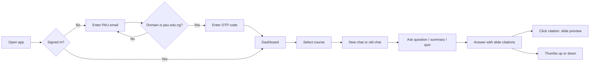
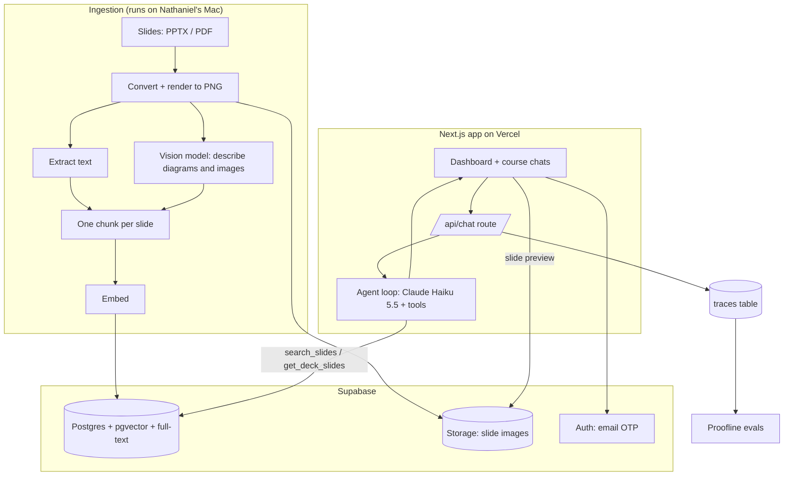
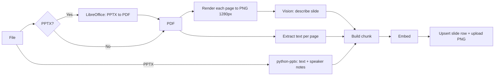
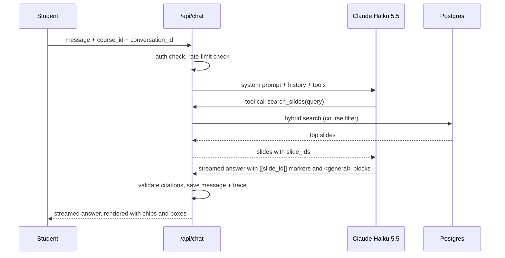
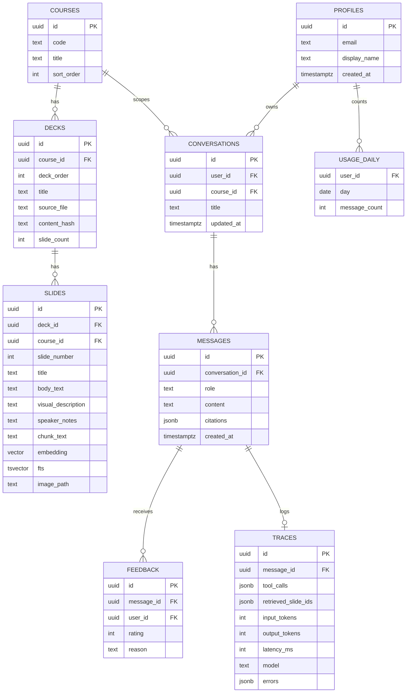
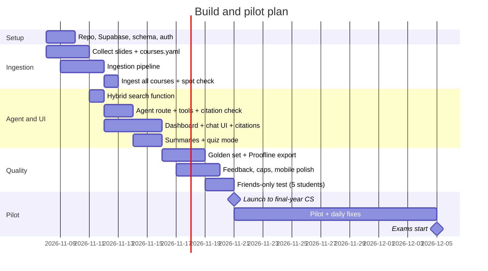

# PAU Study Assistant — Product Requirements Document

| Field | Value |
|---|---|
| Owner | Nathaniel Ilesanmi |
| Status | Draft v1.0 — ready for build |
| Date | 7 November 2026 |
| Pilot users | Final-year Computer Science students, Pan-Atlantic University (PAU) |
| Hard deadline | Exams start **5 December 2026**. Pilot must be live by **21 November 2026**. |

---

## 1. Summary

PAU Study Assistant is a web app. Final-year CS students sign in with their `@pau.edu.ng` email. They see one chat for each course. Each chat answers questions from that course's lecture slides, and it cites the slide it used.

The slides are already loaded. The student does not upload anything.

The app has a second purpose. It gives real users and real traces to **Proofline**, the agent evaluation harness. Each conversation becomes eval data.

---

## 2. Problem

Students already study with ChatGPT and Claude. But for each study session they must:

1. Find the correct slide decks on the school portal.
2. Download them.
3. Upload them into a chat again and again (file limits, new chats, lost context).
4. Trust answers that do not show which slide they came from.

Near exams, this friction costs time. Answers that mix slide content with general knowledge also confuse students. They do not know what the lecturer actually taught.

---

## 3. Goals and non-goals

### 3.1 Goals (MVP)

| ID | Goal |
|---|---|
| G1 | A student can ask a question about any final-year CS course and get an answer grounded in that course's slides, with slide citations. |
| G2 | The answer shows clearly which parts come from the slides and which parts are general knowledge. |
| G3 | A student can ask for a summary of a topic, a week, or a deck. |
| G4 | A student can ask the assistant to quiz them on a topic. |
| G5 | Pilot is live for students by 21 November 2026, two weeks before exams. |
| G6 | Every request writes a trace that Proofline can use. |
| G7 | Cost stays predictable, with a hard daily cap per student. |

### 3.2 Non-goals (MVP)

- Other departments or levels.
- Per-student course enrollment. All CS final-year courses show for all students.
- Live web search. General knowledge comes from the model only.
- Past questions (v2).
- Voice (v2).
- Mobile app (v2).
- MCP server / integration with NotebookLM and other tools (v2).
- Student file upload.
- Payments.

---

## 4. Users

| Persona | Description | Main need |
|---|---|---|
| Exam crammer | Final-year CS student, 1–3 weeks before exams. Studies late at night, often on a phone. | Fast, correct answers tied to what the lecturer taught. |
| Catch-up student | Missed lectures. Has never opened some decks. | Summaries of weeks and decks, in order. |
| Self-tester | Knows the material, wants to check it. | Quiz questions with answers and slide references. |
| Builder (Nathaniel) | Owner and operator. | Traces, feedback, cost visibility, easy re-ingestion of slides. |

---

## 5. Success metrics

The primary signal is **direct student feedback**: students say it helped, and they can say how.

| Metric | Target for pilot (21 Nov – 5 Dec) | Source |
|---|---|---|
| Students who sign in | ≥ 30 | `profiles` table |
| Weekly active students | ≥ 50% of signed-in students | `messages` table |
| Thumbs-up rate | ≥ 75% of rated answers | `feedback` table |
| Survey: "It helped me study" (agree / strongly agree) | ≥ 70% | End-of-pilot survey |
| Citation precision (cited slide supports the claim) | ≥ 90% on the golden set | Proofline |
| p95 time to first token | ≤ 3 s | Traces |
| LLM cost | ≤ $100 for the full pilot | `usage` table + provider dashboard |

---

## 6. Scope — features and acceptance criteria

### F1. Sign in with school email

- The student enters an email. The app sends a one-time code (OTP).
- Only `@pau.edu.ng` addresses are accepted. The server rejects all other domains before it sends a code.
- First sign-in asks for a display name (optional).

**Acceptance**
- `someone@gmail.com` → error "Use your PAU email." No email is sent.
- `student@pau.edu.ng` → code arrives, sign-in works, session lasts 30 days.

### F2. Dashboard with course chats

- After sign-in, the student sees a sidebar with one item per course (code + title, e.g. "CSC 401 — Compiler Construction").
- Each course has its own list of conversations ("New chat" button per course).
- The main area shows the selected conversation.
- Works on a phone (sidebar collapses into a drawer).

**Acceptance**
- All configured courses show for every student.
- A new chat in CSC 401 only retrieves CSC 401 slides.

### F3. Grounded Q&A with slide citations

- The agent searches the course's slides before it answers.
- Each claim from the slides has a citation chip, e.g. `CSC 401 · Week 4 — Parsing · Slide 12`.
- Clicking a chip opens a preview of the slide image and its text.
- If the slides do not cover the question, the agent says so first.

**Acceptance**
- 100% of citations point to slides that the agent actually retrieved in that turn (validated on the server).
- On the golden set, ≥ 90% of cited slides support the claim.

### F4. General knowledge marking

- Content that does not come from the slides is shown in a highlighted box labelled **"Not from your slides — general knowledge"**.
- The agent uses general knowledge only to explain or extend. It never contradicts the slides without saying so.

**Acceptance**
- In the golden set, every answer segment without a citation is inside a general-knowledge box.
- Visual: the box uses a different background color and an icon. It is easy to see on a phone.

### F5. Summaries

- The student can ask: "Summarize week 3", "Summarize the deck on Turing machines", "Give me an overview of the whole course".
- The agent loads the slides of that deck (in order) and writes a structured summary with citations.

**Acceptance**
- A deck summary cites slides from across the deck, not only the first few.
- "Whole course" summary works by deck (one section per deck).

### F6. Quiz me

- The student asks: "Quiz me on regular expressions" (optional: number of questions, difficulty).
- The agent generates questions from retrieved slides. MVP format: one question at a time in chat; the student answers; the agent marks it and cites the slide with the correct answer.

**Acceptance**
- Each question is answerable from the cited slides.
- The agent does not show the answer before the student replies (unless asked).

### F7. Feedback

- Thumbs up / thumbs down on every assistant message. Thumbs down opens an optional short reason ("wrong", "not in slides", "too long", "other" + text).
- A one-question in-app prompt after the 10th message: "Is this helping you study? (1–5)".
- End-of-pilot survey link (external form) shown as a banner from 3 December.

### F8. Usage cap

- Each student has a daily cap of **50 messages** (configurable).
- When a student reaches the cap, the input is disabled with the message "Daily limit reached. Resets at midnight (WAT)."

### F9. Admin and operations (no UI in MVP)

- An ingestion CLI loads and re-loads course slides.
- SQL views show daily active users, messages, cost, and thumbs-up rate.
- All traces export to Proofline format (JSONL).

---

## 7. User flow



---

## 8. System architecture



### 8.1 Technology choices

| Layer | Choice | Reason |
|---|---|---|
| Web app | Next.js (App Router) + TypeScript + Tailwind + shadcn/ui | Fast to build, good streaming support. |
| Hosting | Vercel (free tier for pilot) | Zero-ops deploys. |
| Auth | Supabase Auth, email OTP | Built-in, domain check via server action / auth hook. |
| Database | Supabase Postgres + `pgvector` + Postgres full-text search | One store for app data, vectors, and keyword search. |
| File storage | Supabase Storage | Slide PNGs for citation previews. |
| Chat model | Claude Haiku 5.5 (`claude-haiku-5-5`) | Low cost, fast, good tool use. Swap is one config value. |
| Vision (ingestion) | Claude Haiku 5.5 with image input | Describes diagrams, tables, equations, scanned slides. |
| Embeddings | OpenAI `text-embedding-3-small` (1536 dims) | Very low cost, good quality. |
| Agent framework | Vercel AI SDK (`ai` + `@ai-sdk/anthropic`) | Streaming, tool calls, React hooks. |
| Ingestion | Python 3.12 script (`python-pptx`, `PyMuPDF`, LibreOffice headless) | Best libraries for PPTX/PDF. |
| Evals | Proofline (own harness) | Real traces from real users. |

---

## 9. Ingestion pipeline

### 9.1 Input layout

Slides are never committed to git. They live in `data/slides/` (git-ignored).

```
data/
  courses.yaml
  slides/
    CSC401/
      01-introduction.pptx
      02-lexical-analysis.pdf
      ...
    CSC403/
      ...
```

`courses.yaml`:

```yaml
- code: CSC401
  title: Compiler Construction
  lecturer: Dr. X        # optional
- code: CSC403
  title: Artificial Intelligence
```

The deck order comes from the filename prefix (`01-`, `02-`, ...). The deck title comes from the filename or the first slide's title.

### 9.2 Steps



1. **Normalize**: convert PPTX to PDF with LibreOffice headless. This gives one page per slide and a consistent renderer.
2. **Render**: each page → PNG (1280 px wide). Upload to Supabase Storage at `slides/{course}/{deck}/{n}.png`.
3. **Extract text**: from PPTX use `python-pptx` (titles, body, tables, speaker notes). From PDF use PyMuPDF.
4. **Describe visually**: send the PNG to the vision model **only if** the slide has an image, chart, table, or equation, or if extracted text is shorter than 40 characters (scanned slide). Prompt: describe the diagram, transcribe any equations and tables, keep it under 150 words.
5. **Build chunk**: one chunk = one slide. Content:
   ```
   Course: CSC401 Compiler Construction
   Deck: 04 — Parsing (slide 12 of 31)
   Title: LL(1) parsing table
   Text: ...
   Visual description: ...
   Speaker notes: ...
   ```
   The header gives context to the embedding and to the model.
6. **Embed** the chunk text. Store the vector and a `tsvector` for full-text search.
7. **Idempotency**: each deck has a content hash. Re-running ingestion skips unchanged decks and replaces changed ones.

### 9.3 Size and cost estimate

- About 8–10 courses × 8–12 decks × ~28 slides ≈ **2,000–3,000 slides**.
- Vision calls on ~50% of slides. Total ingestion cost: about **$1–3**. Embeddings: < $0.10.
- Run time: about 20–40 minutes, with parallel vision calls.

---

## 10. Retrieval and agent design

### 10.1 Agent loop



### 10.2 Tools

| Tool | Input | Output | Used for |
|---|---|---|---|
| `search_slides` | `query: string`, `k?: number (default 8)` | List of `{slide_id, deck_title, slide_number, title, content}` | Q&A, quiz topics |
| `list_decks` | — | List of `{deck_id, order, title, slide_count}` for the course | Summaries, "what topics are in this course?" |
| `get_deck_slides` | `deck_id`, `from?`, `to?` | Slides in order (max 40 per call) | Deck / week summaries |

`course_id` is **not** a tool parameter. The server injects it from the chat. The model cannot search other courses.

### 10.3 Hybrid search

1. Vector search: top 20 by cosine similarity, filtered by `course_id`.
2. Full-text search: top 20 by `ts_rank` on the same course. This catches exact terms ("LL(1)", "Dijkstra", "CSC 401").
3. Merge with Reciprocal Rank Fusion (k = 60). Return top `k`.
4. Add neighbor context: for each result, include the title of the slide before and after (helps with slides that continue a topic).

Implemented as one Postgres function `match_slides(course_id, query_embedding, query_text, k)`.

### 10.4 Answer format contract

The model writes Markdown with two extra conventions:

- **Citation marker**: `[[s:<slide_id>]]` placed after the sentence it supports.
- **General knowledge block**:
  ```
  <general>
  ...text that does not come from the slides...
  </general>
  ```

The server and the UI enforce the contract:

- The UI renders `[[s:...]]` as a citation chip and `<general>` as a highlighted box.
- The server checks that every cited `slide_id` was returned by a tool in this turn. Invalid citations are removed and logged as a trace error (`citation_invalid`). This is a Proofline metric.

### 10.5 System prompt (outline)

1. Role: study assistant for `{course_code} {course_title}` at Pan-Atlantic University.
2. Always call `search_slides` (or `get_deck_slides` for summaries) before answering a course question.
3. Cite every claim that comes from the slides with `[[s:id]]`.
4. Put all content that is not from the slides inside `<general>` blocks. Keep general knowledge short and useful.
5. If the slides do not cover the question, say "Your slides don't cover this." first, then give general knowledge inside `<general>`.
6. If the slides and general knowledge disagree, follow the slides and point out the difference.
7. Quiz mode: one question at a time; wait for the answer; mark it; cite the slide.
8. Style: clear, short paragraphs, examples where they help, exam-focused.
9. Do not help with active exam cheating (e.g. "answer this question during my exam now"). Normal revision is always fine.

### 10.6 Context and cost controls

- Send at most the last 12 messages of history.
- Tool results: max 8 slides for search, 40 for deck reads.
- Max output: 1,200 tokens (2,000 for summaries).
- Cache the system prompt (prompt caching).

---

## 11. Data model



### 11.1 Row-level security

- `courses`, `decks`, `slides`: readable by any authenticated user. Writable only by the service role (ingestion).
- `conversations`, `messages`, `feedback`: a user can read and write only their own rows.
- `traces`, `usage_daily`: service role only.

---

## 12. API

| Method | Route | Purpose |
|---|---|---|
| POST | `/api/auth/otp` | Validate domain, request OTP from Supabase. |
| POST | `/api/chat` | Stream an agent answer. Body: `{conversation_id, course_id, message}`. |
| GET | `/api/courses` | List courses. |
| GET/POST | `/api/conversations` | List / create conversations for a course. |
| GET | `/api/conversations/:id/messages` | Load history. |
| POST | `/api/feedback` | Save thumbs up/down + reason. |
| GET | `/api/slides/:id` | Slide preview: signed image URL + text. |

---

## 13. UI

### 13.1 Screens

1. **Sign in** — email field → OTP field. PAU branding kept neutral (no official logo unless the school approves).
2. **Dashboard** — left sidebar: course list (code + short title). Under the selected course: its conversations + "New chat". Main area: empty state with three starter buttons: "Ask a question", "Summarize a week", "Quiz me".
3. **Chat** — messages with streaming; citation chips; general-knowledge boxes; thumbs on each answer; input box with remaining daily messages shown when < 10.
4. **Slide preview** — side panel (desktop) or bottom sheet (phone) with the slide image, deck title, slide number, and a link "Ask about this slide".

### 13.2 Rendering rules

- Citation chip: small rounded label, course color, text `Week 4 · Slide 12`. Multiple chips can follow one sentence.
- General-knowledge box: amber/neutral background, left icon, label "Not from your slides".
- Phone first: test at 375 px width.

---

## 14. Cost model

Assumptions per message: ~6,000 input tokens (system prompt + history + 8 slides), ~500 output tokens. Prices: Claude Haiku 5.5 at $0.10 per million input tokens and $0.50 per million output tokens (prompts under 100K tokens). Check prices on the provider page before launch.

| Scenario | Messages / month | Estimated LLM cost / month |
|---|---|---|
| 50 students × 10 msgs/day × 30 days | 15,000 | ≈ $13–25 |
| 100 students × 15 msgs/day × 30 days | 45,000 | ≈ $40–70 |
| Worst case: 100 students × 50 msgs/day (cap) | 150,000 | ≈ $130–230 |

Hosting: Vercel free tier and Supabase free tier are enough for the pilot (check the Supabase 500 MB database limit: 3,000 slides × ~8 KB ≈ 25 MB, fine).

**Controls**: daily cap per student (F8), history limit, output limit, prompt caching, and a provider-side monthly spend limit.

**After the pilot** (not MVP): options are a free tier + paid tier, a department or sponsor paying, or a cheaper model for simple turns.

---

## 15. Observability and Proofline integration

Each assistant turn writes one `traces` row:

- Input: user message, course, conversation history length.
- Tool calls: name, arguments, returned `slide_id`s, latency.
- Output: final text, citations, invalid citations removed.
- Tokens, cost, model, total latency, time to first token.
- Feedback (joined later).

**Export**: `npm run export:traces -- --since 2026-11-21` writes JSONL in Proofline's format.

**Proofline checks (deterministic first)**:

| Check | Type |
|---|---|
| Agent called a retrieval tool before answering a course question | Deterministic |
| All citations are in the retrieved set | Deterministic |
| No uncited text outside `<general>` blocks (heuristic: sentence-level) | Deterministic |
| Answer stays in the selected course | Deterministic (slide course_id) |
| Cited slide supports the claim | LLM judge |
| "Not covered" questions get the "Your slides don't cover this" response | Deterministic + judge |

**Golden set**: before launch, write 40 questions (5 per course for 8 courses) with expected slide IDs. Mix: direct facts, diagrams-only facts, cross-slide questions, out-of-scope questions, summary requests. Every thumbs-down in the pilot becomes a candidate golden case.

---

## 16. Security, privacy, and content

- Permission to use the slides is confirmed by the school. Keep a written copy of the approval.
- Slides are only visible to signed-in `@pau.edu.ng` users. Slide images use signed URLs that expire.
- Slides are not committed to git and not used to train any model.
- Store the minimum personal data: email, optional display name, conversations.
- Show a short notice at sign-in: what is stored, that conversations are used to improve the app, and how to request deletion.
- Model provider data settings: use API defaults (no training on API data). Confirm before launch.
- Secrets only in Vercel / Supabase environment variables.

---

## 17. Timeline



---

## 18. Risks

| Risk | Impact | Mitigation |
|---|---|---|
| Slides are mostly diagrams; text extraction misses content | Weak answers | Vision descriptions per slide; spot-check 30 slides per course. |
| Model mixes general knowledge into "slide" claims | Students trust wrong content | Citation validation, `<general>` contract, Proofline checks, golden set. |
| OTP emails go to spam on the school mail server | Students cannot sign in | Custom SMTP (e.g. Resend) with a verified domain; test with 3 PAU accounts on day 2. |
| Late build, no time before exams | Low value | Fixed scope; friends-only test on 19 Nov; launch 21 Nov. |
| One user drives high cost | Budget | Daily cap, spend limit at provider, usage dashboard. |
| Lecturers object | Must take slides down | Written approval; one-command removal per course. |
| Supabase free project pauses after inactivity | Downtime | Pilot is active daily; upgrade if needed. |

---

## 19. Open questions

1. Exact list of final-year CS courses this semester and number of decks per course.
2. Is the approval in writing, and does it cover all lecturers' slides?
3. Do PAU email accounts receive external OTP emails reliably?
4. Name and domain for the app (e.g. `*.vercel.app` for the pilot).
5. Which survey tool for the end-of-pilot survey?
6. Should students see each other's usage at all? (MVP: no.)

---

## 20. Roadmap after MVP

| Version | Feature |
|---|---|
| v1.1 | Past questions: ingest past papers, link questions to slides, "practice past questions" mode. |
| v1.2 | Structured quiz UI (multiple choice cards, score). |
| v1.3 | Voice: ask questions by speech, listen to answers. |
| v2.0 | MCP server: students connect the course slides to Claude, ChatGPT, or other tools. |
| v2.1 | Other levels and departments; per-student course selection. |
| v2.2 | Mobile app (PWA first). |
| v2.3 | Lecturer view: anonymous topics that confuse students most. |

---

## 21. Repository layout (planned)

```
pau-study-assistant/
  PRD.md
  README.md
  apps/web/                 # Next.js app
    app/
      (auth)/sign-in/
      (app)/dashboard/
      api/chat/route.ts
      api/...
    components/chat/        # message, citation chip, general box
    lib/agent/              # system prompt, tools, citation validator
    lib/supabase/
  ingestion/                # Python ingestion CLI
    ingest.py
    pptx_extract.py
    pdf_extract.py
    vision.py
    embed.py
  supabase/
    migrations/             # schema, RLS, match_slides()
  evals/
    golden.jsonl
    export_traces.ts
  data/                     # git-ignored
    courses.yaml
    slides/
```
